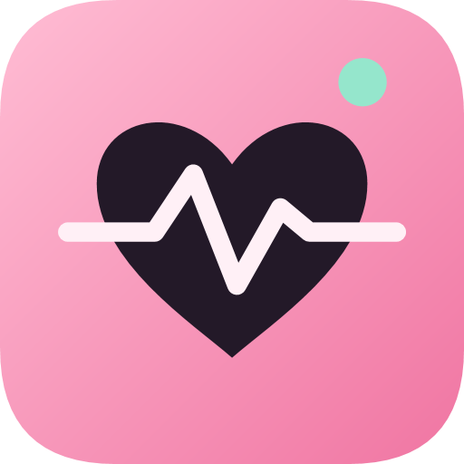
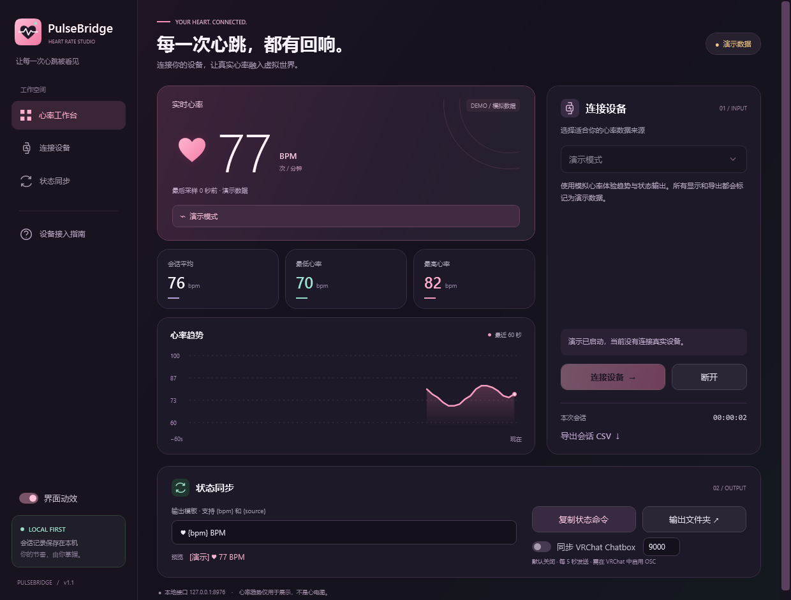

<p align="center">
  
</p>

<h1 align="center">PulseBridge · 心率工作台</h1>

<p align="center">让心跳，成为你的状态。</p>
<p align="center">Windows 10 / 11 · x64 · v1.1.0 · WPF / .NET 10</p>

面向 **NekoTrak 与 VRChat 玩家**的 Windows 心率接收、展示和状态输出工具。将穿戴设备或已有采集程序的心率接到电脑，查看变化，再按接收端配置输出为状态文字。

> 软件负责接收与展示数据，不通过电脑测量心率。下图为演示模式，数值不是实测数据。



## 能做什么

| 功能 | 说明 |
| --- | --- |
| 心率看板 | 实时 BPM、最近 60 秒趋势、会话平均 / 最低 / 最高 |
| 多种数据来源 | 标准蓝牙 BLE 心率广播、Pulsoid 云端、本地 HTTP 推送 |
| 状态输出 | 自定义文本模板，本地 UTF-8 文本、JSON、HTTP 读取 |
| VRChat Chatbox | 提供 OSC 同步选项，需在 VRChat 中启用 OSC |
| 会话记录 | 当前会话样本可导出为 CSV |
| 演示模式 | 无需连接真实设备，所有模拟输出均带演示标识 |

### v1.1 界面更新

- 专属 LOGO 与多尺寸应用图标，提供 SVG / PNG / ICO 素材。
- 深色玫瑰配色、薄荷绿点缀、统一线条图标和深色控件。
- 随有效 BPM 变化的心跳与涟漪、卡片入场、悬停和数字过渡。
- 渐变趋势面积与最新数据点，断流超过 15 秒不跨段连接。
- 动效开关会保存；遵循 Windows 动画设置，最小化或数据失效时停止心跳。
- Windows 11 原生深色标题栏。

## 接入 NekoTrak / VRChat

**NekoTrak：** 本程序提供本地文本与 HTTP 输出，可以按 NekoTrak 自定义状态的命令行表达式功能配置读取。NekoTrak 官方对该功能的介绍见[商店页面](https://store.steampowered.com/app/5249210/NekoTrak/?l=schinese)。这是一条配置接入路线，尚未逐版本实测；具体语法和展示效果请按当前版本确认。

**VRChat：** 在 VRChat 中启用 OSC，然后在本程序中勾选“同步 VRChat Chatbox”。默认向本机 UDP 9000 的 `/chatbox/input` 每 5 秒发送一次。接收端仍需实际环境验证。

设备兼容取决于型号、固件与广播能力；部分第三方云端接入可能需要订阅。详细条件与接入步骤请阅读[使用指南](docs/USER-GUIDE.md)。

## 从源码构建

需要 Windows x64、[.NET 10 SDK](https://dotnet.microsoft.com/download/dotnet/10.0) 和 [.NET Framework 4.8 Developer Pack](https://dotnet.microsoft.com/download/dotnet-framework/net48)。

在仓库根目录运行：

```powershell
powershell.exe -NoProfile -ExecutionPolicy Bypass -File .\Source\build.ps1
```

默认生成自包含程序至 `Build/`。请保留整个目录，双击其中的 `PulseBridge.exe`。构建脚本会先编译 BLE 辅助组件，再发布 WPF 程序。

首次运行可以先选择“演示模式”→“连接设备”。

## 验证

```powershell
.\Build\PulseBridge.exe --self-test --report "$PWD\Build\core-tests.txt"
.\Build\PulseBridge.exe --data-dir "$PWD\Build\ui-test-data" --ui-test "$PWD\Build\ui-tests.txt"
```

v1.1 已通过 **31 项核心检查 + 16 项界面集成检查**，并完成窗口视觉检查。范围与限制见 [TEST-REPORT.txt](TEST-REPORT.txt)。真实穿戴设备、云端账号及 NekoTrak / VRChat 接收端仍需要实机验证。

## 仓库内容

- `Source/`：完整 WPF 源码、BLE 辅助组件源码、LOGO 资源与构建脚本。
- `docs/USER-GUIDE.md`：设备路线、Token、HTTP、OSC 与状态输出说明。
- `docs/images/`：原始演示界面截图。
- `docs/social/`：社交平台介绍图与长短文案。
- `status.ps1`：本地状态读取与离线回退脚本。

[查看社交平台介绍素材](docs/social/README.md)

本工具用于个人状态展示，不用于医疗诊断。

