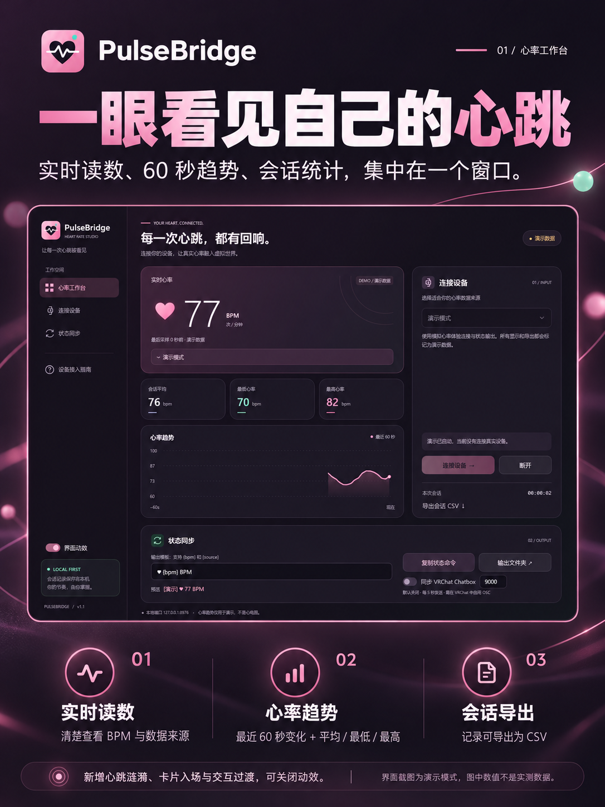
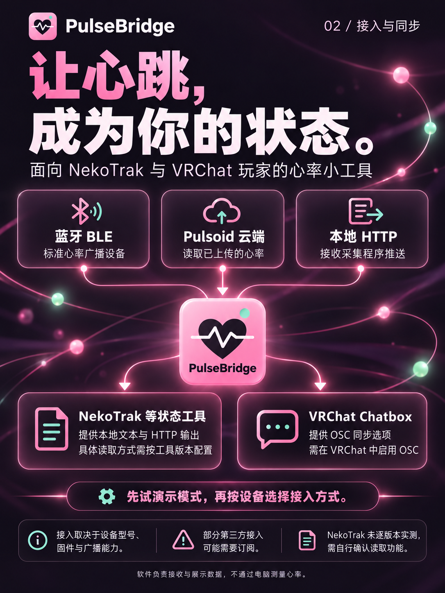

# 社交平台介绍素材

面向 NekoTrak 与 VRChat 玩家，按个人开发分享的口吻准备。

建议图片顺序：

1. [封面](cover.png)
2. [界面与功能介绍](features.png)
3. [接入与同步说明](connections.png)
4. [原始演示界面截图](../images/dashboard-demo.png)，可作补充。

文案：[完整正文](post.txt) · [动态短版](short-post.txt) · [标题备选](titles.txt)

三张宣传海报使用 AI 图像生成制作，沿用项目 LOGO、配色与界面参考。界面细小文字以[原始截图](../images/dashboard-demo.png)为准。图中心率数值均为演示数据。

没有在文案中承诺全设备支持、原生一键联动、免费订阅或未确定的开源许可。NekoTrak 接入需按版本配置，VRChat 接收端也需实际环境验证。

## 封面

## 界面与功能

## 接入与同步

